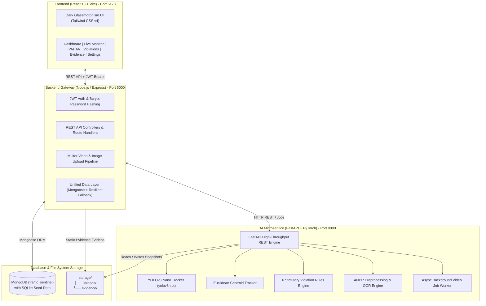

# AI-Powered Intelligent Vehicle Identification & Traffic Violation Detection System Using ANPR

A modern, production-grade Intelligent Transportation System (ITS) re-architected with the **MERN Stack (React 18 + Node.js/Express + MongoDB)** and a dedicated **Python FastAPI AI Microservice (YOLOv8 + ANPR + Computer Vision)**.

---

## 📌 Executive Summary

Modern urban intersections require automated 24/7 enforcement, high-throughput video analytics, and resilient administrative interfaces. This system eliminates manual bottlenecking by:
1. **Separating Inference from Presentation**: Isolating heavy YOLOv8 deep-learning workloads in an asynchronous Python microservice while managing administrative dashboards, audit workflows, and authentication through an enterprise Express and React pipeline.
2. **6 Statutory Traffic Violation Detectors**:
   - 🔴 **Red Light Jump**: Dynamically flags stop-line crossings during active RED signal phases.
   - ⚡ **Over-Speeding**: Calculates real-world velocity using calibrated dual virtual timing lines ($v = \frac{d}{\Delta t} \times 3.6$ km/h).
   - 👥 **Triple Riding / Overloading**: Identifies two-wheelers carrying $>2$ occupants via spatial overlap tracking.
   - 🛡️ **No Helmet Violation**: Inspects rider head ROI for protective compliance.
   - 🔄 **Wrong-Lane / Wrong-Way Driving**: Flags vehicles traversing contrary to designated flow vectors.
   - 📱 **Mobile Phone Usage**: Detects handheld phone operation by vehicle operators.
3. **Automatic Number Plate Recognition (ANPR)**:
   - Bilateral noise filtering, CLAHE contrast enhancement, and contour aspect ratio localization.
   - OCR character disambiguation tailored to Indian registration plate formats (standard and Bharat Series `BH`).
   - Tamper-evident forensic evidence snapshots with picture-in-picture plate insets and statutory watermarks.
4. **VAHAN Vehicle Registry with Automated Secondary Penalties**:
   - Verifies owner registration, insurance policy status, and Pollution Under Control (PUC) certificate validity.
   - **Automated Secondary Penalty**: If an offense occurs while Insurance is expired ($+₹2,000$) or PUC is expired ($+₹1,000$), statutory fines are automatically calculated and compounded into the total e-Challan.
5. **Human-in-the-Loop Review & e-Challan Audit**:
   - Traffic officers can review photographic evidence, approve or reject flagged infractions, mark payments as settled, and dispatch statutory SMS notices.

---

## 🏗️ System Architecture



---

## 📂 Professional Project Directory Structure

```
ANPR/
├── client/                                     # React 18 + Vite + Tailwind CSS v4 Frontend
│   ├── public/
│   ├── src/
│   │   ├── assets/
│   │   ├── components/
│   │   │   ├── common/                         # StatCard, Badge, EmptyState
│   │   │   ├── layout/                         # Sidebar, Navbar, PageHeader
│   │   │   ├── dashboard/                      # MetricCards, InfractionChart
│   │   │   └── violations/                     # ViolationTable, ReviewModal
│   │   ├── pages/
│   │   │   ├── Login.jsx                       # Officer authentication with demo quick-fill
│   │   │   ├── Dashboard.jsx                   # Surveillance overview & analytics
│   │   │   ├── LiveMonitoring.jsx              # Live video stream & signal overrides
│   │   │   ├── VehicleRecords.jsx              # VAHAN mock registry lookup
│   │   │   ├── Violations.jsx                  # Audit table with confirm/reject actions
│   │   │   ├── Evidence.jsx                    # Forensic snapshot inspector
│   │   │   └── Settings.jsx                    # Statutory fine schedule & SMS settings
│   │   ├── layouts/                            # AppLayout shell
│   │   ├── hooks/                              # useAuth, useFetch
│   │   ├── services/                           # Axios API client & endpoints
│   │   ├── context/                            # AuthContext provider
│   │   ├── utils/                              # Constants, fine schedules, colors
│   │   ├── App.jsx                             # Protected route configuration
│   │   └── main.jsx                            # React root mount
│   ├── package.json
│   ├── tailwind.config.js
│   ├── postcss.config.js
│   └── vite.config.js
│
├── server/                                     # Node.js + Express.js Backend Gateway
│   ├── src/
│   │   ├── config/                             # env.js, db.js, seedData.json
│   │   ├── controllers/                        # auth, dashboard, vehicle, violation, ai, settings
│   │   ├── middleware/                         # authMiddleware, uploadMiddleware, errorHandler
│   │   ├── models/                             # User, Vehicle, Violation, ProcessingJob
│   │   ├── routes/                             # auth, dashboard, vehicle, violation, ai, settings
│   │   ├── services/                           # dataStore.js (Mongoose + Resilient Fallback)
│   │   ├── app.js                              # Express application setup
│   │   └── server.js                           # Server listener (Port 5000)
│   └── package.json
│
├── ai-service/                                 # Python FastAPI Computer Vision Microservice
│   ├── app/
│   │   ├── api/                                # /health, /detect/vehicles, /anpr/recognize, /process/video
│   │   ├── services/                           # detector_service, anpr_service, video_worker
│   │   ├── models/                             # Pretrained weights (yolov8n.pt)
│   │   ├── schemas/                            # Pydantic request/response models
│   │   ├── config.py                           # Thresholds, geometry, fine schedules
│   │   └── main.py                             # FastAPI bootstrap (Port 8000)
│   ├── tests/
│   └── requirements.txt
│
├── storage/                                    # Segregated Media Storage
│   ├── uploads/                                # User-uploaded traffic videos & sample_traffic.mp4
│   └── evidence/                               # Forensic watermarked snapshots
│
├── docs/                                       # Technical Documentation
│   ├── architecture.md                         # Detailed architectural specifications
│   └── api-documentation.md                    # Complete REST API reference
│
├── legacy/                                     # Preserved original repo source, SQLite DB & reference utilities
├── .env.example                                # Master environment template
├── .env                                        # Local runtime environment file
├── .gitignore
├── package.json                                # Master dev orchestrator (concurrently)
└── README.md                                   # Master project guide
```

---

## ⚡ Prerequisites

* **Node.js**: v18.0.0 or higher (v20.20+ recommended)
* **npm**: v9.0.0 or higher (v10.8+ installed)
* **Python**: 3.10.x or higher
* **MongoDB**: Optional (The server auto-detects MongoDB; if offline, it runs in built-in resilient SQLite/In-Memory mode with all 14 vehicles and 1,012 violations intact).

---

## 🚀 Installation & Setup

### 1. Install Node Dependencies
From the repository root:
```bash
# Install root orchestrator dependencies
npm install

# Install client dependencies
cd client && npm install

# Install server dependencies
cd ../server && npm install
cd ..
```

### 2. Install Python AI Microservice Dependencies
In a dedicated terminal:
```bash
cd ai-service
pip install -r requirements.txt
cd ..
```

### 3. Environment Configuration
Verify that `.env` exists in the repository root (copied from `.env.example`):
```env
PORT=5000
NODE_ENV=development
CLIENT_URL=http://localhost:5173
JWT_SECRET=super_secret_traffic_sentinel_jwt_key_2026
MONGODB_URI=mongodb://localhost:27017/traffic_sentinel
AI_SERVICE_URL=http://localhost:8000
UPLOAD_DIR=./storage/uploads
EVIDENCE_DIR=./storage/evidence
```

---

## 🎮 How to Run the Services

### Workflow: Start All Services

#### Terminal 1: Full-Stack App (Frontend + Backend)
Run from the root directory:
```bash
npm run dev
```
* **Frontend**: Open `http://localhost:5173`
* **Backend API**: Running at `http://localhost:5000`
* **Health API**: Visit `http://localhost:5000/api/health`

#### Terminal 2: Python AI Microservice
Run from the `ai-service/` directory:
```bash
cd ai-service
python -m uvicorn app.main:app --reload --host 127.0.0.1 --port 8000
```
* **AI Service API**: Running at `http://localhost:8000`
* **Interactive Swagger Docs**: Open `http://localhost:8000/docs`
* **AI Health Check**: Visit `http://localhost:8000/health`

---

## 🔑 Default Officer Login Credentials

| Role | Email | Password | Badge Number |
| :--- | :--- | :--- | :--- |
| **Chief Administrator** | `admin@traffic-sentinel.gov` | `Admin@1234` | `CHIEF-01` |
| **Traffic Inspector** | `officer@traffic-sentinel.gov` | `Officer@1234` | `OFFICER-44` |

*(Quick-fill demo buttons are provided on the login page for one-click access)*

---

## 🧪 Verification & Testing Commands

To verify each service independently:

1. **Test Frontend Production Build**:
   ```bash
   npm run build:client
   ```
2. **Test Backend Service**:
   ```bash
   cd server && node src/server.js
   ```
3. **Test AI Microservice**:
   ```bash
   cd ai-service && python -m uvicorn app.main:app --port 8000
   ```

---

## ⚠️ Current Limitations & Future Enhancements

### Current Limitations:
1. **Dedicated Helmet & License Plate Models**: Helmet detection currently inspects edge gradients in the rider's upper head bounding box, and plate localization uses Sobel contours.
2. **Video Streaming Format**: Live monitoring on the web client utilizes high-performance HTML5 canvas/video playback. For multi-camera production CCTV nodes, an RTSP-to-HLS/WebRTC transcoding pipeline (e.g., via MediaMTX or FFmpeg) is recommended.

### Future Enhancements:
1. **Custom YOLOv8 Number Plate Classifier**: Training a dedicated YOLOv8 bounding box model exclusively on Indian HSRP high-security registration plates.
2. **Real-time WebRTC Feeds**: Streaming live 4-camera feeds directly from edge IPCams with sub-100ms latency.
3. **Official VAHAN API Integration**: Direct integration with the National Informatics Centre (NIC) VAHAN 4.0 portal API once state clearance credentials are provided.
